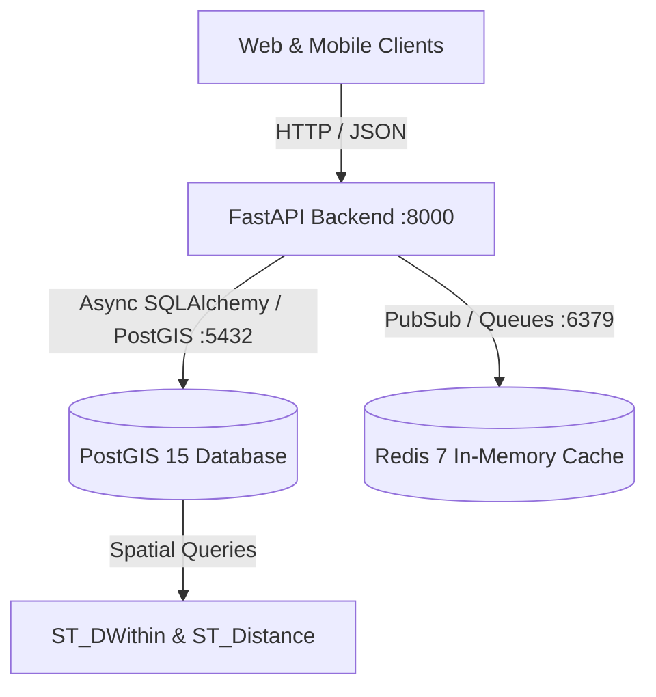

# Save The Serve (S.T.S) - API Documentation & Verification Checklist

This checklist documents the complete OpenAPI interactive API documentation (`/docs`), ReDoc reference (`/redoc`), health check probe endpoints, and containerized deployment infrastructure for **Save The Serve (S.T.S)**.

---

## 1. OpenAPI & Interactive Documentation Checklist (`/docs`)

FastAPI automatically generates an interactive Swagger UI documentation dashboard at **`http://localhost:8000/docs`** and ReDoc specification at **`http://localhost:8000/redoc`**.

### OpenAPI Metadata Configuration
- **Application Title**: `Save The Serve (S.T.S) - Logistics & Aid API`
- **Specification Version**: `1.0.0`
- **License**: Apache 2.0 (`https://www.apache.org/licenses/LICENSE-2.0.html`)
- **Contact**: `dev@savetheserve.org`
- **OpenAPI Schema URL**: `http://localhost:8000/openapi.json`
- **Security Scheme**: `OAuth2PasswordBearer` / `HTTPBearer` (JWT Bearer Token in `Authorization: Bearer <token>`)

---

## 2. API Endpoint Catalog by Module Tag

### Tag 1: `Health & Readiness`
Probes designed for container healthchecks, Kubernetes liveness/readiness, and load balancer traffic routing.

| Method | Endpoint | Description | Auth Required | Status Codes |
|---|---|---|---|---|
| `GET` | `/` | Welcoming root endpoint with service metadata, versions, and documentation URLs | None | `200 OK` |
| `GET` | `/health` | Liveness probe returning service operational status and PostGIS SRID | None | `200 OK` |
| `GET` | `/ready` | Readiness probe actively testing PostgreSQL and PostGIS spatial extension connectivity | None | `200 OK`, `503 Service Unavailable` |

---

### Tag 2: `Authentication & Accounts`
Registration, authentication, JWT token lifecycle, and role switching.

| Method | Endpoint | Description | Auth Required | Status Codes |
|---|---|---|---|---|
| `POST` | `/api/v1/auth/signup` | Register new user profile (`donor`, `ngo`, `driver`) | None | `201 Created`, `400 Bad Request` |
| `POST` | `/api/v1/auth/login` | Authenticate with email/password and obtain JWT token pair | None | `200 OK`, `401 Unauthorized` |
| `POST` | `/api/v1/auth/refresh` | Refresh an expired access token using a valid refresh token | None | `200 OK`, `401 Unauthorized` |
| `GET` | `/api/v1/auth/me` | Fetch active user profile, assigned role, and associated NGO detail | Bearer JWT | `200 OK`, `401 Unauthorized` |

---

### Tag 3: `Donations Management`
Physical donation creation, perishable countdown watchdog, proximity discovery feed, 15-minute claims, and earmarked escrow funding.

| Method | Endpoint | Description | Auth Required | Status Codes |
|---|---|---|---|---|
| `POST` | `/api/v1/donations` | Post physical donation (cooked food, groceries, blankets, medical, other) or monetary contribution | Bearer JWT (`Donor`) | `201 Created`, `422 Unprocessable` |
| `GET` | `/api/v1/donations/feed` | Geospatial discovery feed filtered by latitude, longitude, radius, category, and urgency | Bearer JWT (`NGO`, `Driver`, `Admin`) | `200 OK`, `403 Forbidden` |
| `POST` | `/api/v1/donations/{id}/claim` | Atomically reserve a donation for an NGO with a 15-minute concurrency lock | Bearer JWT (`NGO`) | `200 OK`, `404 Not Found`, `409 Conflict`, `410 Gone` |
| `POST` | `/api/v1/donations/earmarked-fund` | Initiate earmarked escrow funding intent (e.g., '50 Blankets' at $10/unit) | Bearer JWT (`Donor`) | `201 Created`, `404 Not Found`, `422 Unprocessable` |
| `POST` | `/api/v1/donations/earmarked-fund/{id}/confirm` | Confirm payment settlement for earmarked escrow intent, transitioning status `PENDING` ➔ `COMPLETED` | Bearer JWT | `200 OK`, `400 Bad Request`, `404 Not Found` |
| `POST` | `/api/v1/donations/payment-webhook` | Process asynchronous gateway payment events (Stripe / Razorpay) | Gateway Signature | `200 OK` |
| `POST` | `/api/v1/donations/{id}/complete` | NGO or Admin marks donation intake completed | Bearer JWT (`NGO`, `Admin`) | `200 OK`, `404 Not Found` |

---

### Tag 4: `Deliveries & Logistics`
Logistics dispatch, driver acceptance, 6-digit cryptographic OTP handshakes, and GPS telemetry.

| Method | Endpoint | Description | Auth Required | Status Codes |
|---|---|---|---|---|
| `POST` | `/api/v1/deliveries` | NGO/Admin initiates delivery dispatch, generating secure 6-digit OTPs | Bearer JWT (`NGO`, `Admin`) | `201 Created`, `404 Not Found`, `409 Conflict` |
| `GET` | `/api/v1/deliveries` | List available or assigned deliveries | Bearer JWT | `200 OK` |
| `GET` | `/api/v1/deliveries/{id}` | Detailed delivery inspection | Bearer JWT | `200 OK`, `404 Not Found` |
| `POST` | `/api/v1/deliveries/{id}/accept` | Driver accepts available delivery task | Bearer JWT (`Driver`) | `200 OK`, `400 Bad Request`, `409 Conflict` |
| `POST` | `/api/v1/deliveries/{id}/pickup-verify` | Donor pickup handshake: driver submits 6-digit `pickup_otp` (status ➔ `IN_TRANSIT`) | Bearer JWT (`Driver`, `Admin`) | `200 OK`, `401 Unauthorized`, `403 Forbidden` |
| `POST` | `/api/v1/deliveries/{id}/dropoff-verify` | NGO dropoff handshake: driver submits 6-digit `dropoff_otp` + image proof (status ➔ `COMPLETED`) | Bearer JWT (`Driver`, `Admin`) | `200 OK`, `401 Unauthorized`, `422 Unprocessable` |
| `PATCH` | `/api/v1/deliveries/{id}/location` | Driver live GPS telemetry broadcast | Bearer JWT (`Driver`) | `200 OK`, `403 Forbidden` |

---

### Tag 5: `NGO Directory`
Public shelter lookup, capacity management, and category intake toggles.

| Method | Endpoint | Description | Auth Required | Status Codes |
|---|---|---|---|---|
| `GET` | `/api/v1/ngos` | Public directory search with distance calculation, category filters, and capacity toggles | None | `200 OK` |
| `GET` | `/api/v1/ngos/{id}` | Detailed NGO shelter profile inspection | None | `200 OK`, `404 Not Found` |
| `PATCH` | `/api/v1/ngos/{id}/capacity` | NGO coordinator updates intake status, description, and accepted categories | Bearer JWT (`NGO`, `Admin`) | `200 OK`, `403 Forbidden` |

---

### Tag 6: `User Settings` & `Support Desk`
Profile management, push notifications, and support tickets.

| Method | Endpoint | Description | Auth Required | Status Codes |
|---|---|---|---|---|
| `GET` | `/api/v1/settings/profile` | Retrieve profile metadata | Bearer JWT | `200 OK` |
| `PATCH` | `/api/v1/settings/profile` | Update profile information | Bearer JWT | `200 OK` |
| `POST` | `/api/v1/settings/password` | Change password with current password verification | Bearer JWT | `200 OK`, `400 Bad Request` |
| `GET` | `/api/v1/settings/notifications`| Fetch push notification preferences | Bearer JWT | `200 OK` |
| `PUT` | `/api/v1/settings/notifications`| Update push notification preferences | Bearer JWT | `200 OK` |
| `POST` | `/api/v1/support/tickets` | Open new support ticket with priority (`low`, `medium`, `high`, `urgent`)| Bearer JWT | `201 Created` |
| `GET` | `/api/v1/support/tickets` | List user or organization tickets | Bearer JWT | `200 OK` |
| `PATCH` | `/api/v1/support/tickets/{id}` | Coordinator or admin updates ticket triage status | Bearer JWT (`Admin`, `NGO`) | `200 OK` |

---

## 3. Containerized Deployment Architecture



### Docker Compose Stack
The multi-container orchestration is defined in `docker-compose.yml`:
1. **`postgis` (`postgis/postgis:15-3.3`)**:
   - PostgreSQL 15 with spatial extensions (`postgis`, `postgis_topology`).
   - Automatically initializes schema via `./supabase/migrations/20261012000000_init_sts_schema.sql` and `./supabase/seed.sql`.
   - Healthcheck: `pg_isready -U postgres -d save_the_serve`.
2. **`redis` (`redis:7-alpine`)**:
   - In-memory event dispatch and caching.
   - Healthcheck: `redis-cli ping`.
3. **`backend` (FastAPI Dockerfile)**:
   - Python 3.11-slim with GDAL, GEOS, libpq, and curl dependencies.
   - Non-root user execution (`stsuser`).
   - Container healthcheck probe against `http://localhost:8000/health`.

### Deployment Commands:
```bash
# 1. Start all containerized services in background
docker compose up -d --build

# 2. View service logs
docker compose logs -f backend

# 3. Verify health status of all containers
docker compose ps

# 4. Run Pytest test suite inside the container
docker compose exec backend pytest -v

# 5. Stop the containers
docker compose down
```

---

## 4. Test Suite Verification Checklist

All 36 unit, feature, and end-to-end integration tests execute cleanly with 100% pass rate:

- `tests/test_auth.py`: User registration, password validation, JWT tokens, role resolution (5 tests).
- `tests/test_donations.py`: Cooked food expiry validation, non-perishable categories, PostGIS feed filters, 15-min reservation locks, concurrency locks (17 tests).
- `tests/test_services_and_deliveries.py`: Expiry watchdog 2-hour dynamic escalation, driver delivery claims, OTP pickup/dropoff verification, NGO directory, settings & support (11 tests).
- `tests/test_integration_lifecycle.py`: Complete operational cycle (Donor ➔ PostGIS feed ➔ NGO Claim ➔ Driver Assign ➔ Pickup OTP ➔ Drop-off OTP ➔ Completed), monetary earmarked escrow payment flow, and health/readiness probe verification (3 tests).

**Execution command**:
```bash
pytest -v
# Output: 36 passed in 11.13s (100% pass rate)
```
