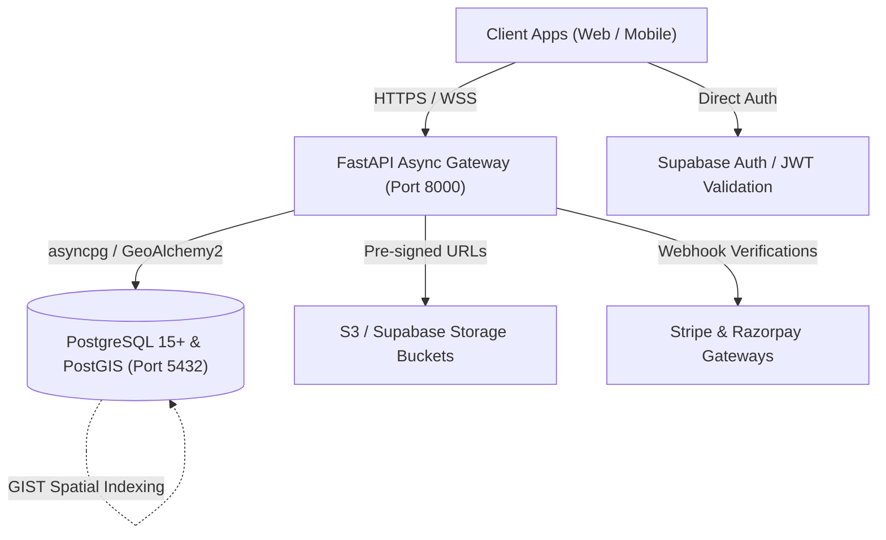
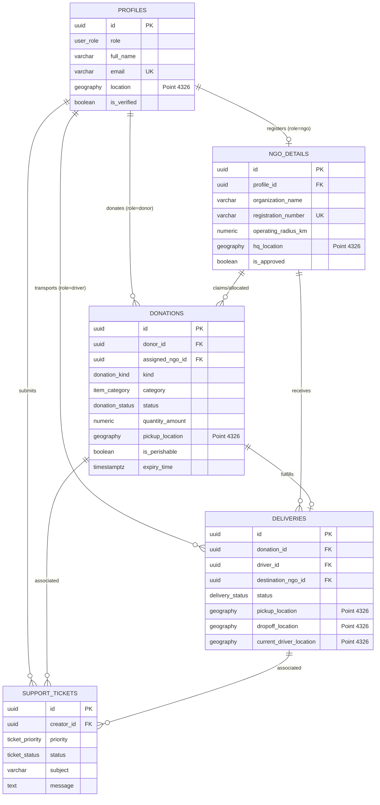

# Save The Serve (S.T.S) — Backend Architecture & Core Schema

> **Platform Mission**: High-performance, geospatial food and essentials rescue engine connecting donors, verified NGOs, and volunteer drivers in real time to eliminate edible food waste and direct relief to community kitchens.

---

## 🏗️ Architecture Blueprint



---

## 🗄️ Database Entity-Relationship (ER) Overview



---

## 📍 PostGIS Geospatial Capabilities

### 1. Spatial Columns
All location-sensitive entities (`profiles.location`, `ngo_details.hq_location`, `donations.pickup_location`, `deliveries.pickup_location`, `deliveries.dropoff_location`, `deliveries.current_driver_location`) utilize:
```sql
GEOGRAPHY(POINT, 4326)
```
- Standard WGS84 ellipsoidal coordinates (longitude, latitude).
- Accurate geodesic distance computations in meters across city and regional boundaries without planar projection distortion.

### 2. GIST Spatial Indexing
Each geography column is indexed via PostgreSQL Generalized Search Tree (`GIST`):
```sql
CREATE INDEX idx_donations_pickup_location_gist ON donations USING GIST (pickup_location);
```
Enables sub-millisecond bounding-box filtering and nearest-neighbor radius scans (`ST_DWithin`, `ST_Distance`).

### 3. Built-in SQL Spatial Procedures
- **`get_available_donations_within_radius(lon, lat, radius_meters)`**: Rapidly identifies available food batches for community pantries within an NGO's operating radius.
- **`get_nearby_approved_ngos(lon, lat, max_search_meters)`**: Locates nearby registered and verified rescue kitchens for surplus donor matching.

---

## 🔒 Row-Level Security (RLS) Policy Matrix

| Table | Operation | Scope / Rule |
| :--- | :--- | :--- |
| **`profiles`** | SELECT | Own profile (`auth.uid() = id`), or public profile of approved NGOs, or Admin. |
| **`profiles`** | INSERT/UPDATE | Strict owner match (`auth.uid() = id`), Admin override for status updates. |
| **`ngo_details`** | SELECT | **Public directory access** for approved NGOs (`is_approved = true`), owner for drafts, Admin for all. |
| **`ngo_details`** | UPDATE | Only NGO owner can edit details; `is_approved` can only be altered by Admin. |
| **`donations`** | SELECT | Donor sees own; NGOs see all `available` batches + claimed batches; assigned driver sees route; Admin sees all. |
| **`donations`** | INSERT | Authenticated users for their own `donor_id = auth.uid()`. |
| **`deliveries`** | SELECT/UPDATE | Assigned driver (`driver_id = auth.uid()`), recipient NGO, or Admin. |
| **`support_tickets`**| ALL | Creator can access own tickets; support agents/Admins can triage all. |

---

## 🚀 Quickstart & Setup Guide

### 1. Prerequisites
- Python 3.11+
- PostgreSQL 15+ with PostGIS extension (or a Supabase project)

### 2. Local Environment Setup
```bash
# 1. Clone repository and navigate to workspace
cd "Save The Serve"

# 2. Create and activate a Python virtual environment
python -m venv .venv
# On Windows (PowerShell):
.venv\Scripts\Activate.ps1
# On Linux/macOS:
source .venv/bin/activate

# 3. Install core dependencies
pip install -r requirements.txt

# 4. Copy environment configuration
cp .env.example .env
```

### 3. Database Migration Deployment

#### Option A: Supabase CLI
```bash
# Initialize and push migration to local/remote Supabase
supabase db push
# Or run migration directly
supabase db execute --file supabase/migrations/20261012000000_init_sts_schema.sql
```

#### Option B: Direct PostgreSQL / psql
```bash
psql -h localhost -U postgres -d save_the_serve -f supabase/migrations/20261012000000_init_sts_schema.sql
psql -h localhost -U postgres -d save_the_serve -f supabase/seed.sql
```

### 4. Running the FastAPI Application
```bash
uvicorn app.main:app --host 0.0.0.0 --port 8000 --reload
```
- **Interactive Swagger Documentation**: [http://localhost:8000/docs](http://localhost:8000/docs)
- **ReDoc Documentation**: [http://localhost:8000/redoc](http://localhost:8000/redoc)
- **Health Probe**: [http://localhost:8000/health](http://localhost:8000/health)
